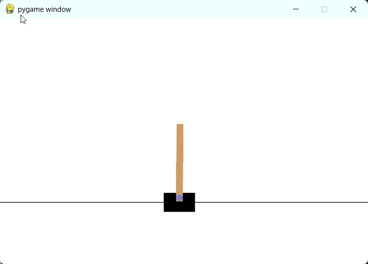
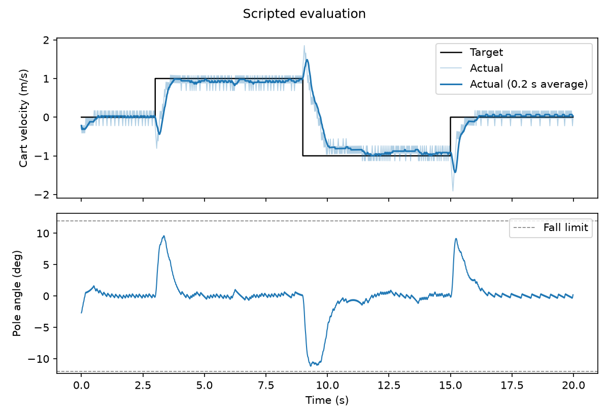

# Cart-Pole with Velocity Commands (DQN)

A Deep Q-Network agent that balances the classic cart-pole while driving the cart at a commanded velocity. Hold the left or right arrow key and the cart speeds up in that direction without dropping the pole. Let go and it comes to a stop.



## How it works

- **Observation:** the four standard CartPole states plus the commanded velocity (−1, 0 or +1 m/s).
- **Reward:** each step earns between 0 and 1 depending on how close the cart's velocity is to the command. Dropping the pole costs 10.
- **Training:** 800 episodes of up to 2,000 steps. The command changes randomly every 50–300 steps.
- **Track edges:** a wrapper moves the cart to the opposite edge instead of ending the episode, so only a dropped pole ends it.
- **Agent:** Double DQN with soft target updates, Huber loss and a 500k-transition replay buffer.

## Results

After training or loading, the script runs a fixed 20-second test (0 → +1 → −1 → 0 m/s) and saves this plot:



| Command | Time to settle | Error after settling |
| --- | --- | --- |
| 0 → +1 m/s | 0.60 s | 0.13 m/s |
| +1 → −1 m/s | 1.84 s | 0.14 m/s |
| −1 → 0 m/s | 0.66 s | 0.10 m/s |

On a full reversal the pole leans to 11.2°, just under the 12° limit. The reward only scores velocity error, so the agent learned to use almost all of the available lean to accelerate as hard as possible.

## Running it

```
pip install -r requirements.txt
python main.py
```

For GPU training, install the CUDA build of PyTorch from [pytorch.org](https://pytorch.org/get-started/locally/) first.

The script asks two questions:

1. **Load saved weights?** Answer `y` to use the trained model in `Cartpole-State/cartpole.pth`.
2. **Train?** Answer `n` to skip straight to the demo, or `y` to keep training. With no saved weights it always trains.

During training, press **Esc** to stop early. Training curves are saved to `training_curves.png` and the weights to `Cartpole-State/cartpole.pth`.

After the test run, close the plot window to start the live demo. Use the **left and right arrow keys** to steer.

The `keyboard` package reads keys globally. On Linux it needs root, and on macOS the terminal needs Accessibility permission.

## Files

- `main.py`: environment wrapper, training loop, scripted evaluation and keyboard demo
- `agent.py`: the DQN network, replay memory and agent (optimizer, soft updates, save/load)
- `Cartpole-State/cartpole.pth`: trained weights
